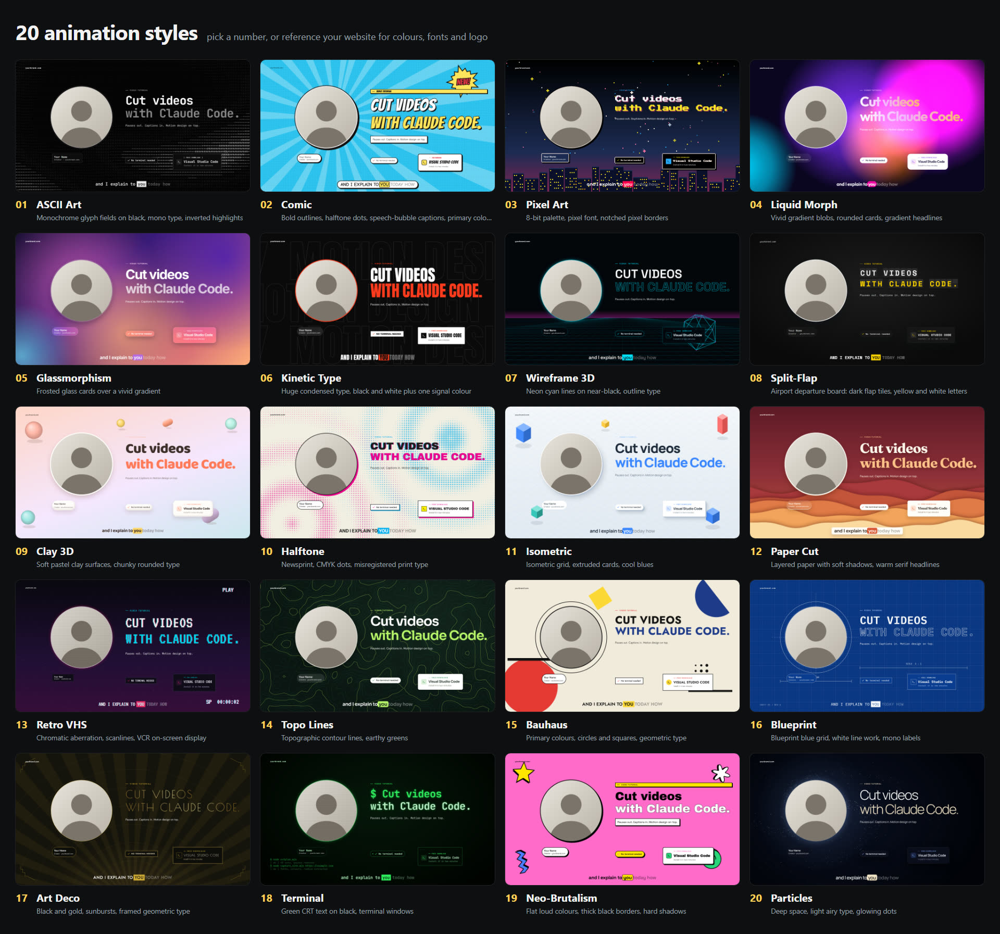

# claudevideo: cut your videos with Claude Code (or Codex)

`cut-video-motion-design` is an agent skill that turns a raw screen recording or talking-head video into a finished edit:

- pauses cut out
- animated captions
- zooms and spotlights on what you click
- motion-design cards
- screenshots of the websites you mention, as B-roll
- one of 20 animation styles, your own website's look, or both

Everything runs on your computer with **Node, Playwright, ffmpeg and Whisper**. There are no video frameworks (no Hyperframes, no Remotion), no accounts and no credits.

## What it does

- **Transcribes** with Whisper (whisper.cpp) and gets the timing of every word.
- **Cuts the pauses** while keeping a natural rhythm: a bit more air at sentence ends, less mid-sentence. It drops breaths, clicks and Whisper's made-up "Thank you." at the end.
- **Adds captions**, one clean line at a time. Words light up as you say them and a highlight glides from word to word.
- **Zooms and spotlights** the buttons, menus and list items you talk about.
- **Adds motion-design cards**: product cards, shortcuts, checklists, numbers, step-by-step cards, a typing prompt, and your real audio waveform with the pauses collapsing.
- **Uses websites as B-roll.** Playwright screenshots every site you mention and shows it in a 3D carousel, a browser frame or a scrolling page.
- **Applies an animation style.** Pick from 20 styles, each with its own fonts, colours and animated background.
- **Copies your brand.** Give it your website and it reads the fonts, colours, corner radius, easing and heading style, so the video looks like your site. You can combine both: a style, tinted with your brand.
- **Delivers** a 1080p MP4 at 30 or 60 fps, with loudness-normalised voice and subtle sound effects.

Before it touches your video, the skill does three things:

1. It **searches the web for open-source assets** (logos, icons, emoji, Lottie animations, sound effects, music, stock footage) and checks their licences.
2. It **sets up the project** (Playwright, fonts).
3. It **renders the board below with your own headline** and asks which style you want, and whether to reference your website.

It then shows you **preview frames first** and renders the MP4 only after you've seen them.

## 20 animation styles



The styles:

- 01 ASCII Art
- 02 Comic
- 03 Pixel Art
- 04 Liquid Morph
- 05 Glassmorphism
- 06 Kinetic Type
- 07 Wireframe 3D
- 08 Split-Flap
- 09 Clay 3D
- 10 Halftone
- 11 Isometric
- 12 Paper Cut
- 13 Retro VHS
- 14 Topo Lines
- 15 Bauhaus
- 16 Blueprint
- 17 Art Deco
- 18 Terminal
- 19 Neo-Brutalism
- 20 Particles

Every style moves, for example a living ASCII field, a flipping departure board, a headline that types itself in a terminal, a technical drawing that draws itself, or a particle galaxy around the speaker. Captions, cards, spotlights and the intro and outro all adapt to the chosen style. You can try them yourself:

```
node style.mjs board --title "Your headline" --title2 "second line"   # the board, with your text
node style.mjs use 18                                                 # apply one (here: Terminal)
```

## Install

### Claude Code: as a plugin (recommended)

Inside Claude Code:

```
/plugin marketplace add zinolang-cell/claudevideo
/plugin install cut-video-motion-design@claudevideo
```

Or from a terminal:

```
claude plugin marketplace add zinolang-cell/claudevideo
claude plugin install cut-video-motion-design@claudevideo
```

### Claude Code: manually

Copy the skill folder into your personal skills folder:

```bash
git clone https://github.com/zinolang-cell/claudevideo.git
cp -r claudevideo/skills/cut-video-motion-design ~/.claude/skills/
```

Windows (PowerShell):

```powershell
git clone https://github.com/zinolang-cell/claudevideo.git
Copy-Item -Recurse claudevideo\skills\cut-video-motion-design "$env:USERPROFILE\.claude\skills\"
```

Use one method, not both, or the skill shows up twice.

### Codex / ChatGPT

The skill uses the open `SKILL.md` format. Copy the same folder into `~/.codex/skills/`:

```bash
cp -r claudevideo/skills/cut-video-motion-design ~/.codex/skills/
```

## Requirements

| What | Why | How to get it |
| --- | --- | --- |
| Node.js 18+ | Runs all scripts | [nodejs.org](https://nodejs.org) |
| ffmpeg (with libx264) | Cutting, encoding, audio | Windows: `winget install Gyan.FFmpeg` · macOS: `brew install ffmpeg` · Linux: `sudo apt install ffmpeg` |
| whisper.cpp + a model | Transcription with word timing | Windows: release zip from [whisper.cpp releases](https://github.com/ggml-org/whisper.cpp/releases) · macOS: `brew install whisper-cpp` · model: `ggml-large-v3-turbo.bin` from [Hugging Face](https://huggingface.co/ggerganov/whisper.cpp/tree/main) |
| Chromium for Playwright | Screenshots and rendering | The skill runs `npx playwright install chromium` |

The skill checks all of this (`check_env.mjs`) and tells you what's missing. Plan for about 1–2 GB of temporary disk space per 3 minutes of video, and a multi-core CPU. No GPU is needed.

## Use it

1. Put your recording in a folder and open that folder in VS Code with the Claude Code extension, or in a terminal.
2. Ask for the edit, for example:

   ```
   @my-recording.mp4 cut this video: remove the pauses, add captions and motion design,
   and use https://your-website.com as the style reference
   ```

3. Answer the style question. Look at the preview contact sheets it shows you and ask for changes.
4. Let it render the MP4. It lands next to your recording as `my-recording_edit.mp4`.

Tips:

- **Model:** a strong model with high effort gives the best edits; Opus 5.5 at high or extra-high effort works well. Expect roughly 8 minutes of agent time for a 60-second video, plus the render.
- **Websites become B-roll.** Mention websites and tools by name while you record, and they'll appear as B-roll.
- **Pre-download assets.** Keep logos, sounds or music you want to use in the project folder. The skill also finds open-source ones itself and keeps a credits list in `assets/ledger.json`.

## How it works

```
recording.mp4
  ├─ Whisper (whisper.cpp, DTW word timing) ──> words ──> pause cut plan + caption lines
  ├─ ffmpeg ──> kept frames (screen layer, webcam layer) + voice track, frame-exact
  ├─ Playwright ──> your website: screenshots + design tokens ──> brand.css
  │             └─> websites you mention ──> B-roll screenshots
  └─ timeline.mjs (edit decisions, anchored to spoken words)
         └─> compose/ (an HTML page that draws any frame from its time) ──> Playwright, frame by frame ──> ffmpeg MP4 + sound
```

Every frame is a pure function of time, so any moment can be previewed in seconds and the render runs in parallel. On a 20-thread CPU it renders about 40–60 frames per second.

## What's inside

```
skills/cut-video-motion-design/
├── SKILL.md                  the workflow the agent follows
├── references/               asset sources and licences, Whisper, Playwright capture,
│                             timeline format, design rules, troubleshooting
└── scripts/                  check_env, transcribe, words, cutplan, cut_media,
                              capture_site, brand_from_tokens, render,
                              compose/ (the compositor page), templates/
.claude-plugin/               plugin + marketplace manifests for Claude Code
```

## Licence

[MIT](LICENSE). This repo ships code and docs only. Fonts, icons, logos, sounds, music and stock footage you download while using it keep their own licences; see [THIRD_PARTY_NOTICES.md](THIRD_PARTY_NOTICES.md) and [`references/asset-sources.md`](skills/cut-video-motion-design/references/asset-sources.md).

Brand names and logos belong to their owners. This project is not affiliated with or endorsed by Anthropic, OpenAI or any other company mentioned.

## Author

Made by Zino Lang. Watch the tutorial on YouTube at [@LearnLanguageModel](https://www.youtube.com/@LearnLanguageModel) and find more at [learnlanguagemodel.com](https://learnlanguagemodel.com). The tutorial video that introduces this skill was edited with it.
